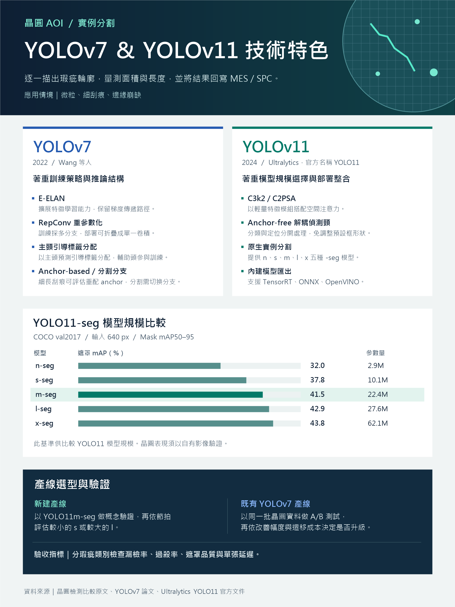

# YOLOv7 與 YOLO11 實例分割技術特色比較：半導體晶圓瑕疵檢測

[瀏覽 HTML 網頁](https://aidms-bdm.github.io/cv_computer_vision/yolov7_vs_yolo11_wafer_inspection/yolov7_vs_yolo11_wafer_inspection_v2.html)

[瀏覽 v3 HTML 網頁（加入 YOLO26 比較）](https://aidms-bdm.github.io/cv_computer_vision/yolov7_vs_yolo11_wafer_inspection/yolov7-11-26-wafer-inspection_v3.html)

比較 YOLOv7 與 YOLO11 兩代模型在**實例分割（Instance Segmentation）** 上的技術特色，並說明如何應用到半導體晶圓瑕疵檢測。內容以製造業客戶的 **QC 產線主管與製程／設備工程師**為對象，重點放在產線指標、選型與導入步驟，不談演算法細節。

## 檔案說明

| 檔案 | 格式 | 用途 |
|---|---|---|
| [yolov7_vs_yolo11_wafer_inspection_v2.pptx](yolov7_vs_yolo11_wafer_inspection_v2.pptx) | PowerPoint |
| [yolov7_vs_yolo11_wafer_inspection_v2.html](yolov7_vs_yolo11_wafer_inspection_v2.html) | 單一 HTML 網頁，提供給客戶閱讀 |
| [yolov7-11-26-wafer-inspection_v3.html](yolov7-11-26-wafer-inspection_v3.html) | 單一 HTML 網頁，加入 YOLO26 比較 | 提供給客戶閱讀 |
| [yolov7_vs_yolo11_infographic.png](yolov7_vs_yolo11_infographic.png) | 一頁式資訊圖（1800 × 2400） | 摘要、行銷活動文宣使用 |

> HTML 檔已把 Logo 圖片內嵌在檔案中，下載後直接用瀏覽器開啟即可，不需要其他檔案。
> GitHub 檔案頁面可查看 HTML 原始碼。要直接閱讀排版後的網頁，請點選上方的「瀏覽 HTML 網頁」。

## 內容大綱

1. **為什麼晶圓檢測需要實例分割**：與物件偵測（畫框）、語意分割比較。實例分割可以逐顆量測瑕疵的面積、長度與位置，讓 Pass/Fail 判定可以量化、可以追溯。
2. **常見晶圓瑕疵與模型需求**：微粒、刮痕、邊緣崩缺、圖形缺陷、殘留／污漬。
3. **兩代模型的技術亮點**
   - **YOLOv7**（2022）：E-ELAN、RepConv 重參數化、主／輔助頭標籤分配；屬 anchor-based，分割功能在獨立的程式分支。
   - **YOLO11**（2024，Ultralytics）：C3k2、C2PSA 空間注意力、anchor-free 解耦偵測頭，原生支援分割，可一鍵匯出 TensorRT／ONNX／OpenVINO。
4. **YOLO11-seg 規格選擇**：n／s／m／l／x 五種規模的 COCO Mask mAP、參數量，以及建議的產線定位。
5. **功能與導入面比較**：支援任務、訓練門檻、部署、長期維護、授權。
6. **對 QC 關鍵指標的影響**：漏檢率、過殺率、檢測節拍（UPH）、人工複判。
7. **導入前的工程課題**：高解析大圖要切圖推論、瑕疵樣本少與類別不平衡、標註一致性。
8. **選型建議**：新產線建議以 YOLO11m-seg 做 POC；已用 YOLOv7 的產線建議先做 A/B 測試再決定是否升級。另附 YOLO26 供參考。
9. **建議導入步驟**：從定義規格、收集標註、POC、影子模式試跑、部署整合 MES／SPC，到持續學習，共六個步驟。

## 重點結論

- **新建產線**：以 YOLO11m-seg 做 POC，再依產線節拍評估改用較小的 s 或較大的 l。
- **既有 YOLOv7 產線**：用同一批晶圓資料做 A/B 測試，再依改善幅度與遷移成本決定是否升級。
- **驗收指標**：依瑕疵類別分別檢查漏檢率、過殺率、遮罩品質與單張推論延遲。

## 使用注意事項

- **COCO 數據僅供參考**：文中的 mAP 是 Ultralytics 官方在 COCO val2017（輸入 640 px）上的結果，只用來比較模型規模之間的相對差異，**不代表在晶圓影像上的實際表現**。實際準確度須用客戶自有的晶圓影像驗證。
- **產線效益是方向性推論**：漏檢率、過殺率等改善是根據技術特性推論的方向，實際幅度依產品、光學條件與樣本量而定。
- **授權**：YOLOv7 為 GPL-3.0；YOLO11 為 AGPL-3.0，商業封閉部署通常需購買 Ultralytics 企業授權。對外提案前請先與法務確認。

## 資料來源

- Wang, C.-Y., Bochkovskiy, A., & Liao, H.-Y. M. (2022). *YOLOv7: Trainable bag-of-freebies sets new state-of-the-art for real-time object detectors.*
- Ultralytics YOLO11 官方文件（COCO val2017 Segmentation 數據）
